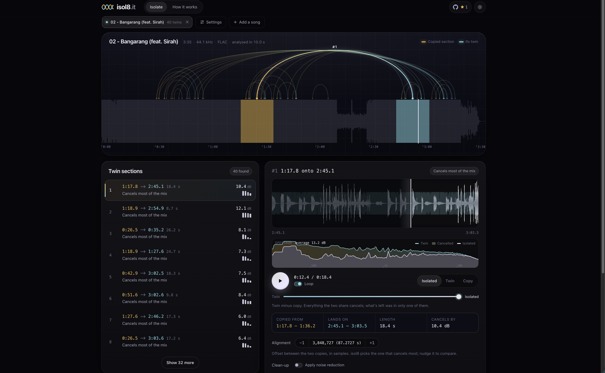

<div align="center">
<a href="https://isol8.it"></a>
</div>

<div align="center">


</div>

<br>

<div align="center">
<b><a href="https://isol8.it">isol8.it</a></b>
</div>

# isol8
Find the hidden sounds in a song.

isol8 detects sections that repeat, such as a chorus, and phase-cancels one copy against the other, leaving only what differs between them. Everything runs in your browser, so nothing is uploaded to a server.

**This is NOT just another vocal remover.** It doesn't estimate or guess: what you hear is exactly what one copy has and the other doesn't.

## Features
- Exact phase cancellation of repeated sections
- Automatic segment detection
- Waveform and section visualisation
- Process results even further:
  - Center & side channel extraction (or a mix of the two)
  - Noise reduction
  - Crop/shorten
  - EQ with low & high cut
- Opens FLAC, WAV, AIFF, MP3, M4A, OGG and Opus (lossless preferred)
- Save results locally as MP3 or WAV
- Installable as an app: open songs with it from your file manager, or send them from the share sheet
- Crossfade between the result and the original section for comparison
- Adjust parameters (for advanced users)

## Screenshots



## How it works
When a song reuses a section, such as a chorus, flipping one copy upside down over the other cancels everything they share. Whatever is left over, like an extra ad-lib or a layer you'd never notice, is what will be returned.

isol8 finds those repeats automatically and lets you listen to and download what's left.

*Everything runs in your browser. Your audio is never uploaded.*

**Still confused?** Visit [isol8.it/how](https://isol8.it/how)

## Limitations
- Results depend on the song. The method needs sections that repeat near-identically, so some songs give little or nothing. When a song does fit, the isolation can be remarkably clean.
- Low quality files will result in a worse isolation and more noise left over. **FLAC is recommended.**

## FAQ
### Doesn't this already exist?
I wasn't able to find an existing tool that uses this method in the same way.

After publishing this project I came across a research paper with a similar concept, **[REPET for Background/Foreground Separation in Audio](https://interactiveaudiolab.github.io/assets/papers/Rafii-Liutkus-Pardo%20-%20REPET%20for%20Background-Foreground%20Separation%20in%20Audio%20-%20Springer%202014.pdf)**. It is the closest thing I could find.

As far as I can tell, REPET uses estimated masks to filter out the repeating background. That works on many more songs and doesn't need near-identical sections. isol8 instead performs an exact cancellation of the repeating parts, which is more precise when it works but applies to fewer songs.

### Does it need a lot of processing power?
No. It runs fine on most modern consumer hardware.

## Run locally

It's a plain static site with no build step. The site lives in `src/` (HTML, CSS, JS and a vendored MP3 encoder).

```bash
npm run serve
```

Or, without npm:

```bash
python3 -m http.server 8080 -d src
```

Then open http://localhost:8080. Locally, the "How it works" page is at http://localhost:8080/how.html.

## Deploy

Upload the `src/` folder to any static host. The repo includes a `wrangler.jsonc` for Cloudflare:

```bash
npx wrangler deploy
```

## Tests

Unit tests need Node 18+ and ffmpeg on your `PATH`:

```bash
npm test
```

Browser tests run in a real Chromium through Playwright and also need the example songs (see below):

```bash
npm i && npx playwright install chromium
```

```bash
npm run test:e2e
```

### Example songs

Some tests check results against songs I isolated by hand. Those songs aren't in the repo. Put them in `../isol8-examples`, or set `ISOL8_EXAMPLES` to their folder. The folder also needs an `examples.json` listing the songs and what was found in each (format in `tests/examples.js`).

Without them, `npm test` still runs everything built on generated audio (FFT, synthetic songs, partial repeats, format decoding, cleanup, regions and shaping) and skips only the engine and probe tests. The browser tests can't run without them.

## License

isol8 is MIT. The MP3 encoder (`src/vendor/lame.min.js`, lamejs) is LGPL-3.0.
